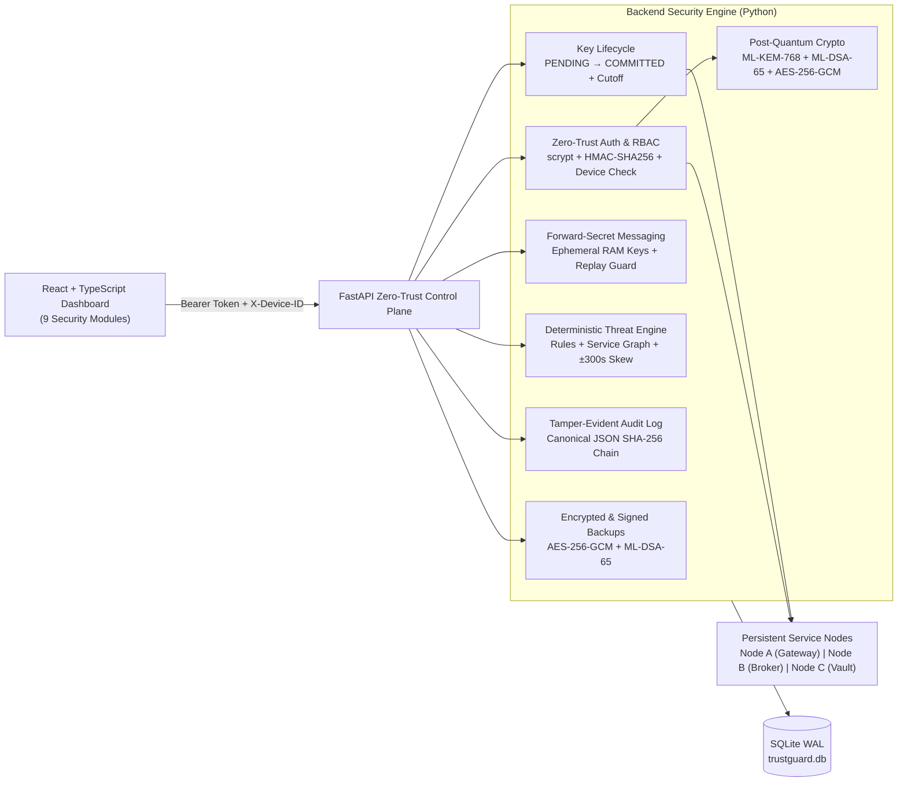

# TrustGuard — Post-Quantum Zero Trust Security Platform

**Protecting confidential messages, cryptographic keys, and service access when keys rotate, devices are lost or revoked, or user permissions change.**

[](#cryptography--forward-secrecy)
[](#cryptography--forward-secrecy)
[](#technology-stack--dependencies)
[](#technology-stack--dependencies)
[](#automated-security-testing)

---

## Table of Contents

- [Why TrustGuard](#why-trustguard)
- [System Architecture](#system-architecture)
- [Cryptography & Forward Secrecy](#cryptography--forward-secrecy)
- [Identity Controls, Key Lifecycle & Node Sync](#identity-controls-key-lifecycle--node-sync)
- [Explainable Threat Detection & Clock-Skew Policy](#explainable-threat-detection--clock-skew-policy)
- [Technology Stack & Dependencies](#technology-stack--dependencies)
- [Clean-Machine Setup & Run Instructions](#clean-machine-setup--run-instructions)
- [Automated Security Testing](#automated-security-testing)
- [Threat Model](#threat-model)
- [Known Limitations](#known-limitations)
- [Project Structure](#project-structure)

---

## Why TrustGuard

Modern enterprise breaches rarely happen because an algorithm was broken in isolation — they happen during **transitions**: when an employee loses a laptop, when keys are rotated mid-flight or during a crash, when a valid credential moves laterally between internal services, or when a backup resurrects a compromised key.

**TrustGuard** demonstrates an end-to-end **Post-Quantum Zero Trust** control plane built around standardized cryptography and deterministic verification:

- **Post-Quantum Native**: Uses NIST FIPS 203 (`ML-KEM-768`) and NIST FIPS 204 (`ML-DSA-65`) via `pqcrypto`, paired with `HKDF-SHA256` and `AES-256-GCM`.
- **Ephemeral Forward Secrecy & Resumable Sessions**: Generates one-time ephemeral `ML-KEM-768` session keys per message/step in volatile RAM (zeroized immediately after delivery) and binds resumable sessions strictly to the authenticated peer and device.
- **Recoverable Key Rotation (`PENDING → COMMITTED`)**: Survives mid-rotation crashes on startup without exposing unverified keys or resurrecting revoked keys, while enforcing documented version cutoffs.
- **Multi-Node Revocation & Offline Catch-Up**: Propagates device and key revocations across three persistent service nodes (`Node A`, `Node B`, `Node C`) with measured per-node enforcement latency.
- **Deterministic Threat Engine (Zero AI/ML)**: Combines explainable rules, a directed zero-trust service topology graph, and `±300s` clock-skew / out-of-order window normalization.
- **Tamper-Evident Audit Chain & Signed Backups**: Links every event via canonical JSON SHA-256 hash chaining from `GENESIS` and detects single-byte corruption or revoked signers in backups.

---

## System Architecture



### Core Capabilities

| Module | Implemented Functionality | Source |
| :--- | :--- | :--- |
| **Users & Identities** | `scrypt` authentication, HMAC-SHA256 tokens, server-side RBAC (`Admin`, `Employee`, `Viewer`), explicit resource overrides, access decision logging | [auth.py](backend/app/auth.py) |
| **Key Management** | `ML-KEM-768` & `ML-DSA-65` keygen, `TRUSTGUARD_MASTER_KEY` envelope wrapping, `PENDING → COMMITTED` rotation, crash recovery, cutoff rejection | [keys.py](backend/app/keys.py) |
| **Device Management** | Endpoint registration, lost/stolen revocation, per-node enforcement timing (ms), replacement enrolment preserving other users | [devices.py](backend/app/devices.py) |
| **Service Nodes (A/B/C)** | Persistent `ONLINE`/`OFFLINE` state, key & device revocation sync, automatic catch-up on node recovery | [nodes.py](backend/app/nodes.py) |
| **Secure Messaging** | Ephemeral `ML-KEM-768` per step, `ML-DSA-65` signatures, recipient AAD binding, replay rejection, peer-bound session resumption | [messaging.py](backend/app/messaging.py) |
| **Threat Detection** | Deterministic rules, directed service graph, `±300s` clock-skew sorting, labelled dataset evaluation (no AI/ML) | [threat_detection.py](backend/app/threat_detection.py) |
| **Audit Logs** | Canonical JSON SHA-256 hash chain from `GENESIS`, anti-injection serialization, secret stripping, chain verifier | [audit.py](backend/app/audit.py) |
| **Recovery & Backups** | AES-256-GCM + ML-DSA-65 backups, corruption & revoked-signer rejection, safe restore preserving revocations | [backup.py](backend/app/backup.py) |

---

## Cryptography & Forward Secrecy

TrustGuard uses **only standardized, peer-reviewed libraries** — never custom cryptography or simulated checks:

1. **Key Encapsulation (`ML-KEM-768`, NIST FIPS 203)** via `pqcrypto.kem.ml_kem_768`:
   - Generates an ephemeral `(pk, sk)` pair in volatile RAM (`EphemeralSessionManager`) for each message and each step of a resumed session.
   - Encapsulates a 32-byte shared secret, derives a unique message key via `HKDF-SHA256` bound to `sender_id`, `recipient_id`, `message_id`, `session_id`, and `session_step`, providing **transport forward secrecy** (the mutable `bytearray` key buffer is overwritten with zeros on delivery; immutable Python `bytes` copies remain subject to Python GC).
2. **Authenticated Encryption (`AES-256-GCM`)** via `cryptography`:
   - Uses random 12-byte nonces (`os.urandom(12)`) and canonical JSON Associated Authenticated Data (AAD) binding sender, device, recipient, session, signing key version, and timestamp.
3. **Digital Signatures (`ML-DSA-65`, NIST FIPS 204)** via `pqcrypto.sign.ml_dsa_65`:
   - Signs canonical digests of message envelopes (including AAD and KEM ciphertext) and encrypted key backup manifests.
4. **Private Key Protection at Rest**:
   - Private keys are wrapped using per-key `HKDF-SHA256` keys derived from `TRUSTGUARD_MASTER_KEY` and `AES-256-GCM` (`key_id` as AAD). Private key material is never returned by APIs or written to logs.

---

## Identity Controls, Key Lifecycle & Node Sync

- **Zero-Trust Access Evaluation**: Every protected endpoint verifies the signed bearer token, confirms the user is `ACTIVE`, validates that the bound `X-Device-ID` is owned by the user and not `REVOKED`, enforces server-side RBAC/ACL policy, and records every `ALLOW`/`DENY` outcome in `access_decisions` and `audit_logs`.
- **Two-Phase Recoverable Key Rotation**:
  1. `PENDING`: Generates and wraps the new key version durably in SQLite before retiring the active key (supporting `simulate_crash=True` testing).
  2. `COMMITTED`: Unwraps and verifies the new key, promotes it to `ACTIVE`, retires the previous key, marks keys older than `active_version - key_grace_versions` as `EXPIRED_CUTOFF`, and propagates across Nodes A, B, and C.
  - On application startup (or via `POST /api/keys/recover-rotation`), interrupted `PENDING` rotations are verified and safely committed or rolled back.
- **Session Resumption & Peer Binding**:
  - `POST /api/messages/sessions` binds a persistent `session_id` to `(initiator_id, initiator_device_id, peer_id)`.
  - Resuming via `POST /api/messages/sessions/{session_id}/resume` increments `step_counter` and allocates a fresh ephemeral `ML-KEM-768` keypair per step. Any other user or unbound device attempting to reuse the `session_id` is rejected (`403 SESSION_TAKEOVER_BLOCKED`) and raises `RULE_SESSION_HIJACK_ATTEMPT`.

---

## Explainable Threat Detection & Clock-Skew Policy

The threat engine ([threat_detection.py](backend/app/threat_detection.py)) is **100% deterministic** (zero LLMs or ML models) and evaluates events across seven explicit rules plus a directed service-topology graph (`client → node-a → node-b → node-c` / `key-vault`):

- `RULE_REVOKED_DEVICE_ACCESS` (`CRITICAL`)
- `RULE_UNUSUAL_SERVICE_PATH` (`HIGH`) — catches lateral traversal even with valid credentials
- `RULE_PRIVILEGE_ESCALATION` (`HIGH`) — distinguishes routine `Admin` work from unauthorized privilege changes
- `RULE_SUSPICIOUS_KEY_OP` (`HIGH` / `CRITICAL`) — cutoff/revoked key usage or rapid consecutive rotations
- `RULE_SESSION_HIJACK_ATTEMPT` (`CRITICAL`)
- `RULE_MULTI_SERVICE_FANOUT` (`MEDIUM` / `HIGH`) — sliding 120s window
- `RULE_REPEATED_DENIALS` (`HIGH`) — sliding 180s window
- `RULE_CLOCK_SKEW_ANOMALY` (`MEDIUM`) — flags timing boundary violations

### Clock-Skew & Out-of-Order Timing Range

- **Supported Clock Offset Tolerance**: `±300 seconds` (`±5 minutes`).
- **Out-of-Order Grace Window**: Late-arriving events within `300 seconds` of the user's timestamp watermark are normalized and inserted in sorted order (`bisect.insort`) into sliding windows rather than breaking FIFO eviction.
- **Uncertain Ordering Flagging**: Events arriving `>= 1s` out of order or with `>= 1s` clock offset are flagged `OUT_OF_ORDER_UNCERTAIN`; offsets or lags exceeding `±300s` trigger `RULE_CLOCK_SKEW_ANOMALY` (`CLOCK_SKEW_EXCEEDED`).

### Labelled Dataset Evaluation ([synthetic_security_logs.json](backend/data/synthetic_security_logs.json))

Evaluated deterministically across an **author-crafted 1,058-event synthetic benchmark** (`1,012` benign, `46` malicious):

| Metric | Measured Result |
| :--- | :--- |
| **Grace Period (Key Rotation Cutoff)** | `1` previous version (`TRUSTGUARD_KEY_GRACE_VERSIONS=1`; token TTL `8h`) |
| **Revocation Time (3 SQLite-Simulated Nodes + Audit)** | `1.55 ms` median (`1.26–2.53 ms` local end-to-end; `0.05–0.09 ms` per-node write; no network RPC) |
| **Timing Range (Clock Skew / Out-of-Order)** | `±300s` (`±5 min`; `>= 1s` lag flagged `OUT_OF_ORDER_UNCERTAIN`) |
| **Precision / Recall / F1 Score** | `1.0` / `0.9565` / **`0.9778`** (`44 TP`, `0 FP`, `2 FN` slow-recon boundary probes) |
| **Median Time to Alert** | `0.0014 ms` |
| **False Alerts / 1,000 Benign Events** | `0.0` |

---

## Technology Stack & Dependencies

### Backend (`backend/requirements.txt`)
| Package | Version | Purpose |
| :--- | :--- | :--- |
| `fastapi` | `0.165.0` | REST API framework and dependency-based server-side authorization |
| `uvicorn` | `0.54.0` | ASGI server |
| `pydantic` | `2.14.4` | Request schema validation |
| `pqcrypto` | `1.0.0` | Standardized `ML-KEM-768` (FIPS 203) & `ML-DSA-65` (FIPS 204) |
| `cryptography` | `50.0.2` | `HKDF-SHA256` key derivation & `AES-256-GCM` authenticated encryption |
| `python-dotenv` | `1.1.0` | Environment variable loading |
| `pytest` / `httpx` | `9.2.0` / `0.28.1` | Automated security test suite |

### Frontend (`frontend/package.json`)
| Package | Version | Purpose |
| :--- | :--- | :--- |
| `react` / `react-dom` | `^18.3.1` | UI component framework |
| `typescript` | `^5.7.3` | Strict static typing |
| `tailwindcss` / `@tailwindcss/vite` | `^4.1.3` | Responsive dark cybersecurity UI |
| `recharts` | `^2.15.1` | Interactive access activity & security event charts |
| `lucide-react` | `^0.475.0` | Security & navigation iconography |
| `vite` | `^6.2.0` | Dev server (proxies `/api` to `:8000`) & production bundler |

---

## Clean-Machine Setup & Run Instructions

### Prerequisites
- **Python 3.11+** (verified on Python `3.14.2`)
- **Node.js 18+** and **npm** (verified on Node `22.23.5` / npm `10.9.9`)

### Option A: Linux / macOS (`bash`)

```bash
# 1. Clone the repository
git clone https://github.com/Siddu-119/Trust-Guard.git
cd Trust-Guard

# 2. Create virtual environment and install backend dependencies
python3 -m venv backend/.venv
backend/.venv/bin/python -m pip install -r backend/requirements.txt

# 3. Configure environment variables (generate fresh local secrets)
cp .env.example .env
MASTER_KEY=$(backend/.venv/bin/python -c "import secrets; print(secrets.token_hex(32))")
TOKEN_SECRET=$(backend/.venv/bin/python -c "import secrets; print(secrets.token_hex(32))")
sed -i.bak "s/^TRUSTGUARD_MASTER_KEY=.*/TRUSTGUARD_MASTER_KEY=${MASTER_KEY}/" .env
sed -i.bak "s/^TRUSTGUARD_TOKEN_SECRET=.*/TRUSTGUARD_TOKEN_SECRET=${TOKEN_SECRET}/" .env
rm -f .env.bak

# 4. Start the FastAPI backend (Terminal 1)
backend/.venv/bin/uvicorn backend.app.main:app --host 127.0.0.1 --port 8000

# 5. Install and start the React frontend (Terminal 2)
cd frontend
npm install
npm run dev -- --host 127.0.0.1 --port 5173
```

### Option B: Windows (`PowerShell`)

```powershell
# 1. Clone the repository
git clone https://github.com/Siddu-119/Trust-Guard.git
cd Trust-Guard

# 2. Create virtual environment and install backend dependencies
python -m venv backend\.venv
& "backend\.venv\Scripts\python.exe" -m pip install -r backend\requirements.txt

# 3. Configure environment variables (generate fresh local secrets)
Copy-Item .env.example .env
& "backend\.venv\Scripts\python.exe" -c "import secrets, pathlib; t=pathlib.Path('.env').read_text(); t=t.replace('0'*64, secrets.token_hex(32)).replace('replace-with-a-random-64-char-local-secret', secrets.token_hex(32)); pathlib.Path('.env').write_text(t)"

# 4. Start the FastAPI backend (Terminal 1)
& "backend\.venv\Scripts\uvicorn.exe" backend.app.main:app --host 127.0.0.1 --port 8000

# 5. Install and start the React frontend (Terminal 2)
cd frontend
npm install
npm run dev -- --host 127.0.0.1 --port 5173
```

Open **http://127.0.0.1:5173/** in your browser (API docs at **http://127.0.0.1:8000/docs**). On first startup, `backend/trustguard.db` initializes automatically with synthetic users, devices, service nodes, PQC keys, and the `GENESIS` audit event.

### Synthetic Test Identities

| Username | Role | Password | Initial Device |
| :--- | :--- | :--- | :--- |
| `alice.admin` | `Admin` | `AdminPass#2026!` | `dev-alice-01` |
| `bob.eng` | `Employee` | `EmpPass#2026!` | `dev-bob-01` |
| `carol.viewer` | `Viewer` | `ViewPass#2026!` | `dev-carol-01` |

---

## Automated Security Testing

Run all **22 automated security tests** (runs fully offline against isolated temporary SQLite databases):

```powershell
# Windows
& "backend\.venv\Scripts\python.exe" -m pytest backend\tests\test_trustguard.py -v
```
```bash
# Linux / macOS
backend/.venv/bin/python -m pytest backend/tests/test_trustguard.py -v
```

**Test Coverage (`22/22` passing)**:
1. Authorized user access & Zero-Trust evaluation
2. Unauthorized user rejection (`403 Forbidden`)
3. Key rotation while authorized transfers continue
4. Old key rejection after cutoff (`EXPIRED_CUTOFF`)
5. Device & key revocation across all 3 service nodes (with offline catch-up)
6. Replacement device enrolment preserving other users' access
7. Crash simulation during `PENDING` key rotation
8. Startup crash recovery (`PENDING → COMMITTED`) preserving revocations & data
9. Corrupted backup & revoked-signer backup rejection
10. Audit log tampering detection
11. Audit log injection & secret-leakage prevention
12. Routine `Admin` actions vs. privilege escalation
13. Lateral movement detection with valid credentials (`node-c → node-a`)
14. Out-of-order event processing & `±300s` clock-skew anomalies
15. Duplicate message replay rejection (`409 REJECTED_REPLAY`)
16. Wrong recipient rejection & recipient-only reading
17. Message ciphertext integrity verification (`AES-256-GCM` + `ML-DSA-65`)
18. Ephemeral forward secrecy verification & RAM zeroization
19. Incomplete message rejection & delivery under loss/reordering
20. Resumable session peer binding & session takeover blocking (`403 SESSION_TAKEOVER_BLOCKED`)
21. Concurrent browser `Promise.all` burst stability (32 simultaneous calls, zero `500` errors)
22. Admin delete employee enforcement (server-side RBAC, key revocation, token invalidation, audit integrity)

### Production Frontend Build Verification

```bash
cd frontend && npm run build
```

---

## Threat Model

| Protected Asset | Threat / Attack Vector | TrustGuard Mitigation |
| :--- | :--- | :--- |
| **Confidential Messages** | Harvest-now-decrypt-later quantum adversary; long-term key compromise | Ephemeral `ML-KEM-768` per step (RAM zeroized on delivery) + `HKDF-SHA256` + `AES-256-GCM` |
| **Message Authenticity & Sessions** | Replay attacks, recipient substitution, session ID hijacking | Unique `message_id` tracking, AAD recipient binding, `ML-DSA-65` signatures, strict `(initiator, device, peer)` session binding |
| **Private Keys & Backups** | Database read/leak, corrupted backup restore, resurrection of revoked keys | At-rest AES-256-GCM wrapping (`TRUSTGUARD_MASTER_KEY`), `ML-DSA-65` signed backups, revoked-key non-resurrection |
| **Identity & Service Topology** | Compromised endpoint device, unauthorized RBAC bypass, lateral movement | Server-side RBAC + active device check on every call, multi-node revocation sync, directed service-graph policy |
| **Audit Trail** | Log tampering, newline/JSON log injection, credential leakage | Canonical JSON SHA-256 hash chain from `GENESIS`, server-derived actor ID, forbidden-field stripping |

---

## Known Limitations

1. **Single-Process Ephemeral Store & Simulated Nodes**: Ephemeral session keys live in single-process Python RAM (`EphemeralSessionManager`), and Service Nodes A/B/C are simulated via persistent SQLite tables rather than separate networked containers. Multi-worker execution (`--workers > 1`) is not supported without a shared volatile key store.
2. **Transport-Only Forward Secrecy & Best-Effort Python Zeroization**: After ephemeral transport decryption succeeds at the delivery gate, `inbox_sealed_b64` is stored under `TRUSTGUARD_MASTER_KEY` so recipients can reload delivered messages in the UI. In addition, clearing mutable `bytearray` key buffers in Python is best-effort because immutable `bytes` intermediates are managed by Python's allocator/GC rather than `mlock`/`memset_s`.
3. **Audit-Chain Tail Truncation**: `audit_logs` uses an internal SHA-256 hash chain from `GENESIS`, which detects mid-chain edits or deletions, but without an external WORM anchor or periodic signed head checkpoint, deletion of trailing rows at the end of the table cannot be detected from the database alone.
4. **Slow-Recon Window Boundary**: Deterministic sliding windows (`120s` fan-out, `180s` repeated denials) keep benign false positives at `0.0/1k` on the author-crafted benchmark, meaning low-rate probes spaced hours apart (`stealth_slow_recon`) are not flagged.
5. **Master Key Management**: `TRUSTGUARD_MASTER_KEY` is provided via environment variables rather than a hardware HSM or OS TPM.

---

## Project Structure

```text
.
├── .env.example                          # Environment template (no real secrets)
├── .gitignore
├── README.md
├── backend/
│   ├── requirements.txt
│   ├── data/
│   │   └── synthetic_security_logs.json  # 1,058 labelled events for evaluation
│   ├── app/
│   │   ├── __init__.py
│   │   ├── config.py                     # Env-based settings loader
│   │   ├── database.py                   # SQLite WAL schema & synthetic seed data
│   │   ├── crypto.py                     # ML-KEM-768, ML-DSA-65, HKDF, AES-GCM, ephemeral RAM
│   │   ├── audit.py                      # Canonical JSON SHA-256 hash-chained logs
│   │   ├── auth.py                       # scrypt auth, HMAC tokens, RBAC + device check
│   │   ├── nodes.py                      # Persistent Nodes A/B/C & offline catch-up sync
│   │   ├── keys.py                       # Keygen, PENDING->COMMITTED rotation, cutoff policy
│   │   ├── devices.py                    # Enrolment, revocation propagation & timing
│   │   ├── messaging.py                  # Forward-secret messaging, resumption & replay guard
│   │   ├── threat_detection.py           # Deterministic rules, graph & ±300s clock skew
│   │   ├── backup.py                     # AES-GCM + ML-DSA-65 backups & safe restore
│   │   └── main.py                       # FastAPI REST endpoints & startup crash recovery
│   └── tests/
│       └── test_trustguard.py            # 22 automated security tests
└── frontend/
    ├── package.json
    ├── vite.config.ts
    ├── tsconfig.json
    ├── index.html
    └── src/
        ├── main.tsx
        ├── App.tsx                       # Auth screen + 9-tab dashboard router
        ├── types.ts
        ├── api/client.ts
        ├── components/
        │   ├── Layout.tsx                # Dark cybersecurity sidebar + node status header
        │   └── StatusBadge.tsx
        └── pages/
            ├── OverviewPage.tsx
            ├── UsersPage.tsx
            ├── KeysPage.tsx
            ├── MessagesPage.tsx
            ├── DevicesPage.tsx
            ├── ThreatDetectionPage.tsx
            ├── AuditLogsPage.tsx
            ├── RecoveryBackupsPage.tsx
            └── SettingsPage.tsx
```
